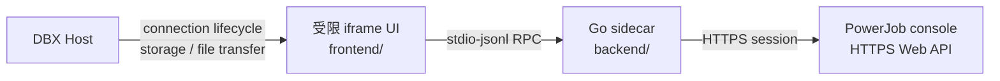

# 架构

## 组件边界

- `frontend/` 是 React + TypeScript 工作台。它只通过 `frontend/host.ts` 调用 DBX bridge，不直接访问 PowerJob。
- `backend/` 是 Go sidecar，维护连接会话、登录状态、输入校验、字段投影和 PowerJob HTTP 请求。
- `scripts/` 负责构建 UI、开发启动、测试和发布。
- `manifest.json` 声明连接字段、权限、入口和 workbench；`dbx-plugin.toml` 声明 Go backend 和 UI 构建方式。

## 请求路径

1. DBX 创建或测试连接，sidecar 在 `backend/client.go` 登录并建立 session。
2. 连接成功后，sidecar 按连接 ID 保存 session；断开连接时删除 session。
3. UI 调用 `invoke(connectionId, method, params)`。
4. `backend/main.go` 按方法把请求路由到 `read.go`、`write.go` 或工作流实现。
5. session 给 PowerJob 请求附加应用 ID、会话令牌和 JSON body，并把返回字段投影为 UI 契约。
6. sidecar 把结果或结构化错误返回 DBX bridge。

## 状态和生命周期

连接 session 只存在于 sidecar 进程内。工作流保存日志保存在 session 内，页面刷新可通过 RPC 恢复，sidecar 重启或断开重连后失效。应用选择、面板尺寸和画布布局属于 UI 状态，使用 DBX `host.storage` 保存。

前端不应把旧连接、旧任务或旧工作流请求的异步结果写入当前页面。涉及连接、应用或选中对象的操作必须在完成时再次检查上下文。

## 修改边界

- 新增 PowerJob 能力：先定义前后端 RPC 契约，再实现 sidecar 路由和 UI 调用。
- 修改字段：同步更新 Go 字段投影、TypeScript 类型、契约测试和本文件引用。
- 修改宿主交互：同时检查 `AGENTS.md` 中的 iframe、表单、模态框和 storage 约束。
- 修改发布：保持 `package.json`、`manifest.json`、backend metadata 和 Git tag 版本一致。

